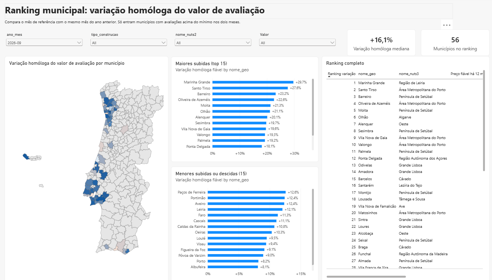
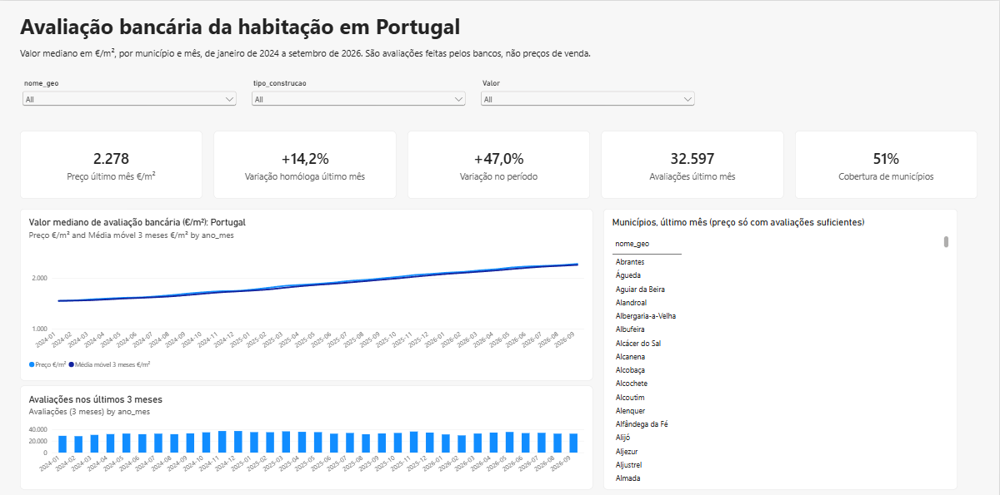
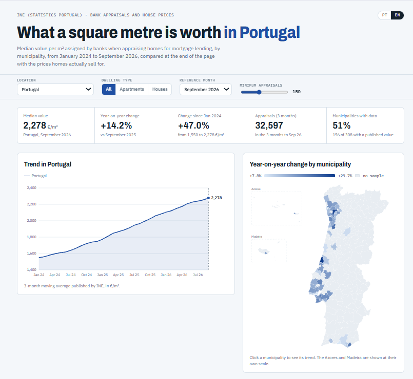
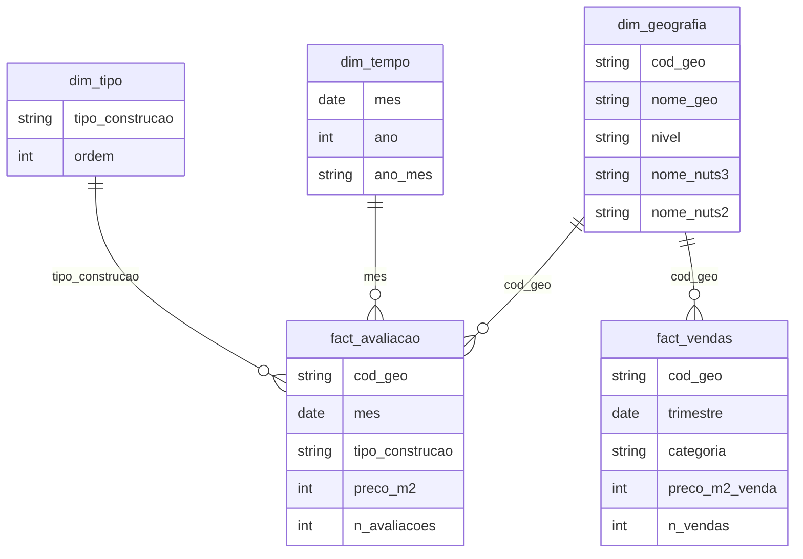

# Housing in Portugal: Bank Appraisals

**[Live dashboard](https://habitacao-pt.vercel.app/#en)** · **[Portfolio](https://rodrigoportfolios.vercel.app/)** · [Português](#português)

A Power BI report on the median value per m² that banks assign when appraising homes for mortgages in Portugal, by municipality, from January 2024 to September 2026. The repository has the full Power BI project in PBIP format (model, measures and report as text), the data, and a bilingual web version of the dashboard.



| Power BI: overview page | Web version |
| --- | --- |
|  |  |

## What the report answers

- How much is a square metre of housing worth in each municipality, according to bank appraisals?
- How did it change in the last 12 months, and since January 2024?
- Which municipalities rose the most, once small samples are filtered out?
- How far are bank appraisals from the prices homes actually sell for, in each municipality?

## Data sources

| Data | Source |
| --- | --- |
| Median bank appraisal value (€/m²) and number of appraisals, monthly, by municipality and dwelling type | INE (Statistics Portugal), *Inquérito à Avaliação Bancária na Habitação*. Published as 3-month moving values. Extracted on 6 November 2026. |
| Median sale price (€/m²) and number of sales over the last 12 months, quarterly, by municipality and category (new, existing) | INE, *Estatísticas de preços da habitação ao nível local* (Metodologia 2022), indicators 0012234 and 0014363. Downloaded from the INE API by [etl/fact_vendas.py](etl/fact_vendas.py), Q4 2019 to Q2 2026. |
| Municipal boundaries for the map | CAOP, Direção-Geral do Território. Mainland from CAOP 2025, Madeira and Azores from the archipelago layers. |

These are bank appraisals, not sale prices. More than half of the municipality-month cells have no published value, which is why the report uses a minimum number of appraisals before showing a price.

The data preparation (encoding fixes, a three-line header, reshaping to a star schema) is documented step by step in [docs/etl-habitacao.html](docs/etl-habitacao.html). Download the file and open it in a browser.

## Repository structure

| Path | Contents |
| --- | --- |
| `HabitacaoPT.pbip` | Opens the project in Power BI Desktop. |
| `HabitacaoPT.SemanticModel/` | The data model in TMDL: tables, relationships, measures, Power Query. |
| `HabitacaoPT.Report/` | The report in PBIR: three pages (overview, municipal ranking, and appraisal vs. sale price), including the custom shape map. |
| `dados/` | The five CSV tables the model loads (star schema). |
| `etl/fact_vendas.py` | Downloads the INE sale-price data and writes `dados/fact_vendas.csv`. |
| `mapas/municipios_pt.json` | TopoJSON of the 308 municipalities, keyed by the model's municipality names. |
| `medidas.dax` | All DAX measures in one readable file. |
| `web/` | Source of the web version: `template.html`, `build.js` and the generated `index.html`. |
| `docs/` | Screenshots and the ETL write-up. |

## Data model



`param_min_avaliacoes` is a disconnected what-if table (0 to 400 appraisals) that drives the minimum sample. `_Medidas` holds the measures. `fact_vendas` is quarterly, so it links only to `dim_geografia`; its measures pick the latest quarter themselves.

## Key measures

| Measure | What it does |
| --- | --- |
| `Preço €/m²` | Appraisal value for the selection, falling back to the national figure when no geography is filtered. |
| `Preço fiável €/m²` | The value only when the number of appraisals reaches the chosen minimum. |
| `Variação homóloga fiável` | Year-on-year change, only when both months meet the minimum. |
| `Ranking variação` | Rank of each municipality by year-on-year change (`RANKX` over `ALLSELECTED`). |
| `Variação homóloga mediana` | Median year-on-year change across ranked municipalities. |
| `Cobertura de municípios` | Share of municipalities with a published value in the latest month. |
| `Preço venda €/m²` | Median sale price over the last 12 months (latest quarter), for the selected municipality, NUTS II region or Portugal. |
| `Avaliação 12 meses €/m²` | Average reliable appraisal value over the same 12 months as the sale price. |
| `Diferença avaliação vs venda` | How far the appraisal is above (+) or below (−) the sale price. |

The full DAX is in [medidas.dax](medidas.dax).

## How to open the project

1. Install a recent [Power BI Desktop](https://www.microsoft.com/power-platform/products/power-bi/desktop) (free, Windows).
2. Clone or download this repository.
3. Open `HabitacaoPT.pbip`.
4. Point the model to your copy of the data: **Transform data > Manage parameters > Pasta**, set it to the full path of the `dados` folder, ending with `\` (for example `C:\Users\you\habitacao-pt\dados\`).
5. Select **Refresh**.

## Web version

The web version recomputes the same measures in JavaScript from the same CSVs, with D3.js for the charts and map. It includes the appraisal vs. sale price comparison. To regenerate it after changing the data:

```bash
node web/build.js
```

It writes `web/index.html`, a single self-contained page. The build script also prints a check against the Power BI figures (national value, number of ranked municipalities, median and top three, and the national sale price, appraisal gap and number of comparable municipalities). To refresh the sale prices first, run `python etl/fact_vendas.py`.

## License

The code, Power BI report and documentation are under the [MIT License](LICENSE). The data is not: the appraisal figures belong to INE (Statistics Portugal) and the municipal boundaries to Direção-Geral do Território, and any reuse must credit those sources.

---

## Português

**[Dashboard ao vivo](https://habitacao-pt.vercel.app/)** · **[Portefólio](https://rodrigoportfolios.vercel.app/)**

Relatório Power BI sobre o valor mediano por m² que os bancos atribuem nas avaliações para crédito à habitação em Portugal, por município, de janeiro de 2024 a setembro de 2026. O repositório tem o projeto Power BI completo em formato PBIP (modelo, medidas e relatório em texto), os dados e uma versão web bilingue do dashboard.

### Fontes

- **INE**, Inquérito à Avaliação Bancária na Habitação: valores medianos (€/m²) e número de avaliações, mensais, por município e tipo de construção, em médias móveis de 3 meses. Dados extraídos a 6 de novembro de 2026.
- **INE**, Estatísticas de preços da habitação ao nível local: valor mediano das vendas por m² e número de vendas nos últimos 12 meses, trimestrais, por município (indicadores 0012234 e 0014363), descarregados com `etl/fact_vendas.py`.
- **CAOP, Direção-Geral do Território**: limites municipais para o mapa.

São avaliações bancárias, não preços de venda. Mais de metade das combinações município-mês não tem valor publicado, por isso o relatório só mostra o preço quando o número de avaliações atinge o mínimo escolhido.

O tratamento dos dados está explicado passo a passo em [docs/etl-habitacao.html](docs/etl-habitacao.html).

### Como abrir o projeto

1. Instala uma versão recente do Power BI Desktop (gratuito, Windows).
2. Clona ou descarrega este repositório.
3. Abre o `HabitacaoPT.pbip`.
4. Aponta o modelo para a tua cópia dos dados: **Transformar dados > Gerir parâmetros > Pasta**, com o caminho completo da pasta `dados`, a terminar em `\`.
5. Clica em **Atualizar**.

A estrutura do repositório, o modelo de dados e as medidas principais estão descritos na secção em inglês acima.

### Licença

O código, o relatório Power BI e a documentação estão sob a [licença MIT](LICENSE). Os dados não: os valores de avaliação são do INE e os limites municipais da Direção-Geral do Território, e qualquer reutilização tem de citar essas fontes.
